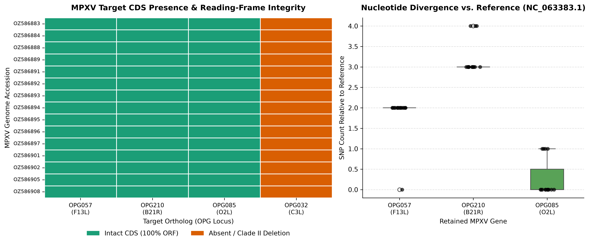

# Poxvirus-CDS-Extractor

An automated, strand-aware comparative genomics pipeline for extracting individual orthologous coding sequences (CDS) across complete Monkeypox virus (MPXV) genomes using local `BLAST+` coordinate mapping and `Biopython`.

## Scientific Motivation
Whole-genome alignments of large double-stranded DNA viruses (~197 kb orthopoxviruses) often obscure gene-level evolutionary dynamics and structural deletions. This workflow automates targeted locus extraction across functional categories—antiviral targets (`OPG057`/`F13L`), surface glycoproteins (`OPG210`/`B21R`), virulence/complement control factors (`OPG032`/`C3L`), and core structural proteins (`OPG085`/`O2L`)—to evaluate open reading frame (ORF) integrity and nucleotide divergence prior to downstream selection and APOBEC3 mutational profiling.

## Key Biological Findings
1. **Clade-Specific Virulence Locus Deletion (`OPG032` / *C3L*):** Local `blastn` screening across 15 complete MPXV genomes (`NC_063383.1` reference context) confirmed **0% presence (0/15)** of the complement control protein *C3L*, consistent with the known deletion of this virulence locus in Clade IIb MPXV lineages relative to Clade I strains.
2. **Complete Reading-Frame Conservation in Retained Targets:** `OPG057` (*F13L*, tecovirimat antiviral target), `OPG210` (*B21R*, immunodominant surface glycoprotein), and `OPG085` (*O2L*, core structural protein) were recovered with **100% intact ORFs (15/15 isolates)**, preserving canonical `ATG` start codons and triplet reading frames without premature stop codons.
3. **Differential Nucleotide Divergence:** Comparing SNP counts relative to `NC_063383.1` highlights locus-specific variation between the larger immunogenic surface glycoprotein (`OPG210`) and conserved core/antiviral loci (`OPG057`, `OPG085`).

## Visual Results


## Repository Architecture
```text
Poxvirus-CDS-Extractor/
├── envs/
│   └── environment.yml               # Reproducible micromamba environment
├── scripts/
│   ├── 01_fetch_mpox_data.py         # Retrieves MPXV reference CDS & complete genomes via Entrez
│   ├── 02_extract_genes_blast.py     # Builds local BLAST+ DB and slices strand-aware orthologs
│   ├── 03_validate_orfs.py           # Verifies ORF integrity (ATG, frame, stops) & counts SNPs
│   └── 04_plot_gene_conservation.py  # Generates presence/integrity heatmap & SNP boxplots
├── data/
│   ├── reference_genes/              # Reference target CDS FASTA
│   └── extracted_cds/                # Extracted per-gene multi-FASTA ortholog alignments
├── results/
│   ├── orf_validation_summary.csv    # Per-genome ORF status and SNP metrics
│   └── figures/                      # High-resolution publication plots
└── run_pipeline.sh                   # End-to-end automated pipeline runner
```

## Setup & One-Command Execution
```bash
# 1. Create and activate environment
micromamba create -f envs/environment.yml
micromamba activate pox-cds

# 2. Run full extraction, validation, and plotting pipeline
chmod +x run_pipeline.sh
./run_pipeline.sh
```
